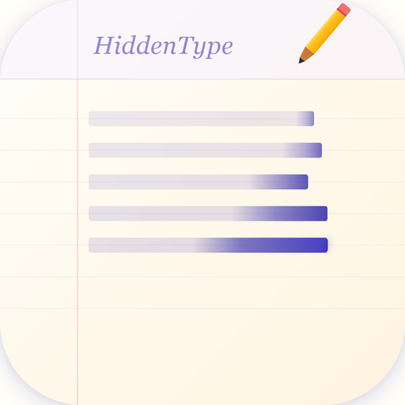
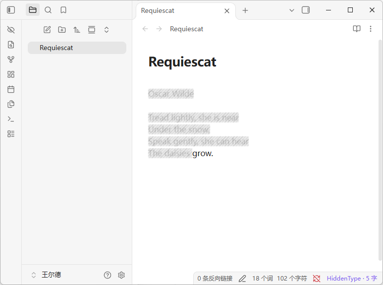
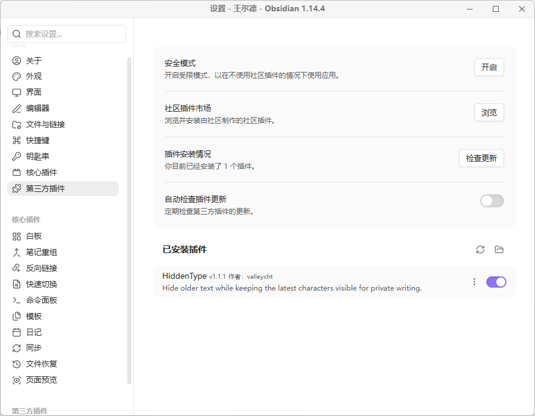
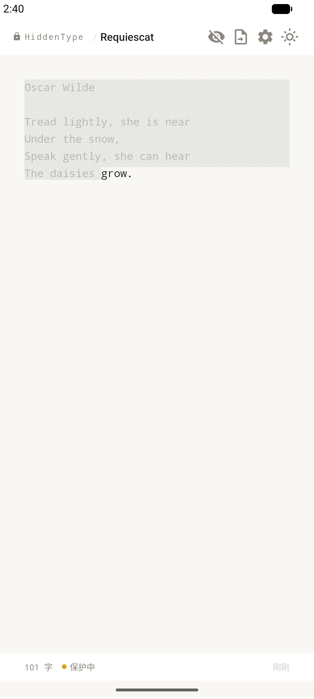
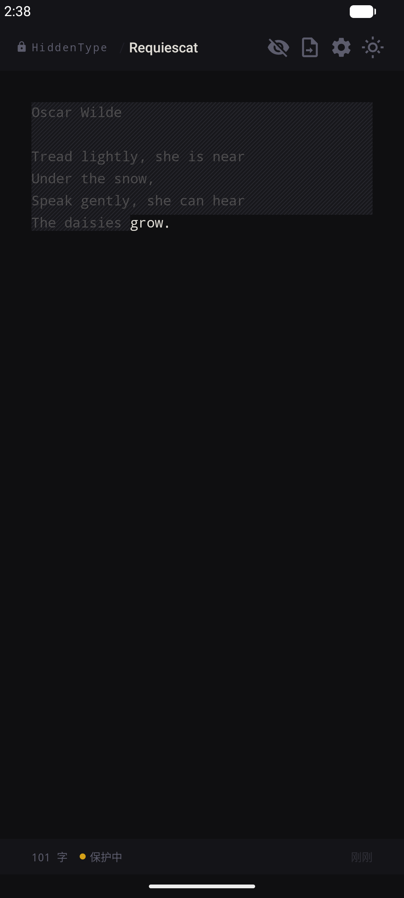
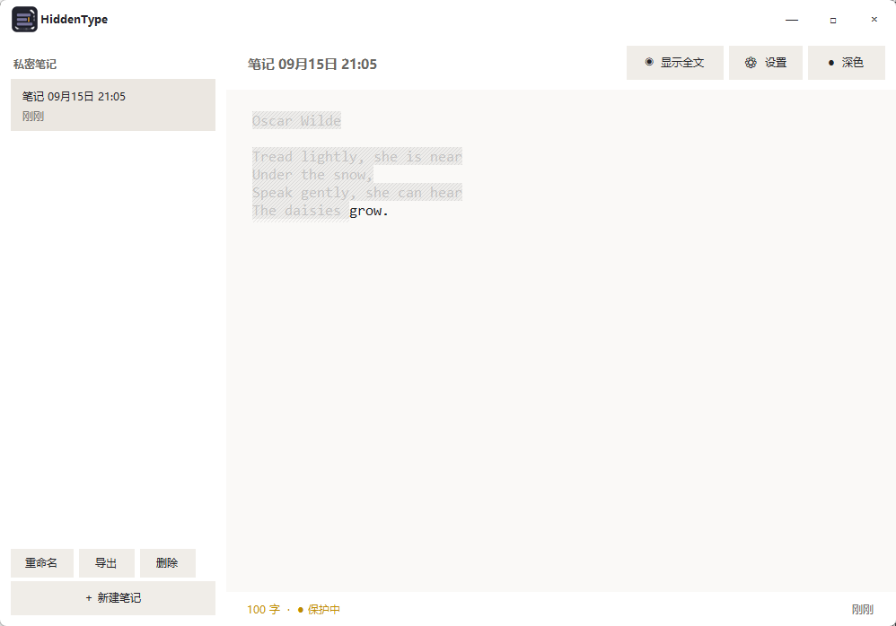
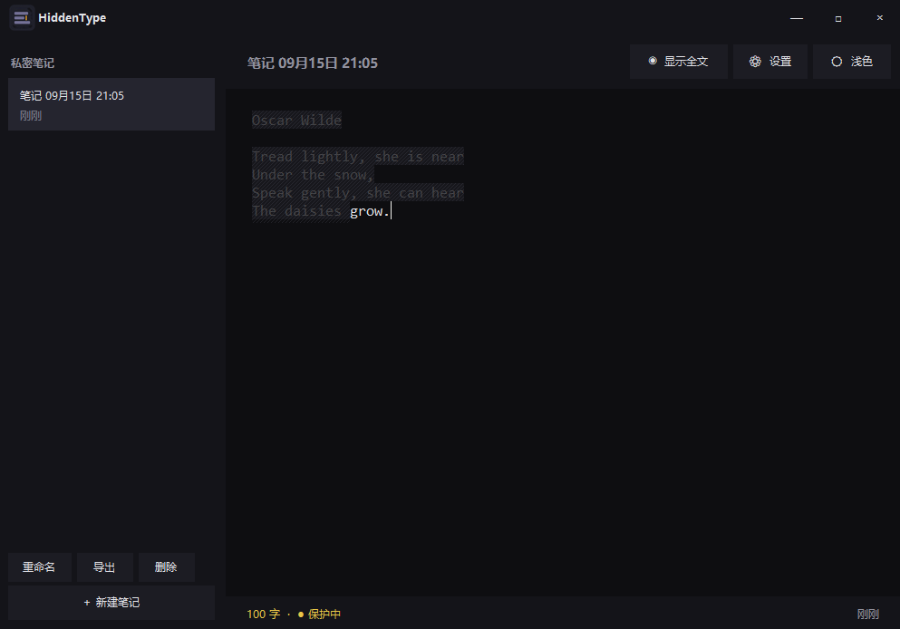

<p align="center">
  
</p>

<h1 align="center">HiddenType · 隐藏码字</h1>
<p align="center">
  在公共场所，也可以自在地码字。<br />
  支持 Obsidian、Windows 和 Android。
</p>

<p align="center">
  <a href="https://github.com/valleyxht/hiddenType/releases/latest"></a>
  
  
  
  <a href="LICENSE"></a>
</p>

<p align="center">
  
  
</p>

<p align="center"><sub>Obsidian 编辑器效果与插件配置</sub></p>
## 为什么做它？

HiddenType 来自一个很简单的需求：在咖啡店、图书馆、地铁等公共场所码网文时，不希望整段剧情一直暴露在屏幕上，也不想因为旁人的目光打断灵感。

输入时，较早的文字会变成低对比度字形，并叠加半透明底膜与细密斜线，只保留最后几个非空白字符清晰可见。故事仍在继续，屏幕却会安静下来。

## 功能

- 自动遮住旧文字，可调节保留 1–50 个非空白字符（空格、Tab 和换行不计数）
- 一键显示或隐藏全文，切到后台后自动恢复遮罩
- 半透明底膜与细密斜线，近处可辨、远处难读
- 本地保存，不修改或上传原文

> [!NOTE]
> HiddenType 提供的是屏幕视觉遮挡，不是加密笔记或密码保险箱。

## 下载

前往 [Releases](https://github.com/valleyxht/hiddenType/releases/latest) 下载：

- Obsidian 插件 ZIP
- Windows 单文件 EXE
- Android APK（Android 14+）

## Obsidian 插件

插件只改变编辑器显示，不修改 Markdown 原文。普通用户不需要安装 Node.js，也不需要运行任何命令。

1. 在 [Releases](https://github.com/valleyxht/hiddenType/releases/latest) 下载 `HiddenType-Obsidian-版本号.zip`。
2. 解压 ZIP，把里面完整的 `hidden-type` 文件夹放进你的 Vault：`.obsidian/plugins/`。
3. 完全退出并重新打开 Obsidian。
4. 点击左下角齿轮，进入“设置 → 第三方插件”。如果尚未开启第三方插件，先按页面提示开启。
5. 在“已安装插件”中找到 **HiddenType**，打开右侧开关。

安装完成后的目录应当是：

```text
你的 Vault/.obsidian/plugins/hidden-type/
├── main.js
├── manifest.json
└── styles.css
```

启用后，可以在“设置 → HiddenType”中调整保留的可见字符数量。左侧眼睛按钮可以临时显示全文，再点一次即可恢复遮罩。

## Android 与 Windows

<table>
  <tr>
    <th width="42%">Android</th>
    <th width="58%">Windows</th>
  </tr>
  <tr>
    <td align="center" valign="top">
      
      
      <br /><sub>本地笔记 · TXT 分享 · 明暗主题</sub>
    </td>
    <td align="center" valign="top">
      
      <br />
      
      <br /><sub>轻量单文件 · 多笔记 · 自动保存</sub>
    </td>
  </tr>
</table>

## 构建

以下内容仅供希望从源码构建或参与开发的用户使用。Android 需要 Android SDK 36 和 JDK 17；Obsidian 插件需要 Node.js；Windows 使用 .NET Framework 4.8。

```bash
.\gradlew.bat testDebugUnitTest assembleDebug
.\windows\test.ps1
cd obsidian-plugin; npm test
```

## License

[MIT](LICENSE) © 2026 valleyxht
